

  <h1>Hesabyar · حسابیار</h1>
  
<b>A Persian, right-to-left accounting and business-management web app: double-entry ledger, sales and inventory, payroll, production, contracting, point of sale and a Persian AI assistant.</b>

  
Built by <b>Dariush Technology</b> · screenshots use sample data · the source code is private

  

    <a href="https://dariush-tech.github.io/hesabyar-showcase/"><b>Live preview</b></a> ·
    <a href="#features">Features</a> ·
    <a href="#screenshots">Screenshots</a>
  

  

    
    
    
    
    
    
  

  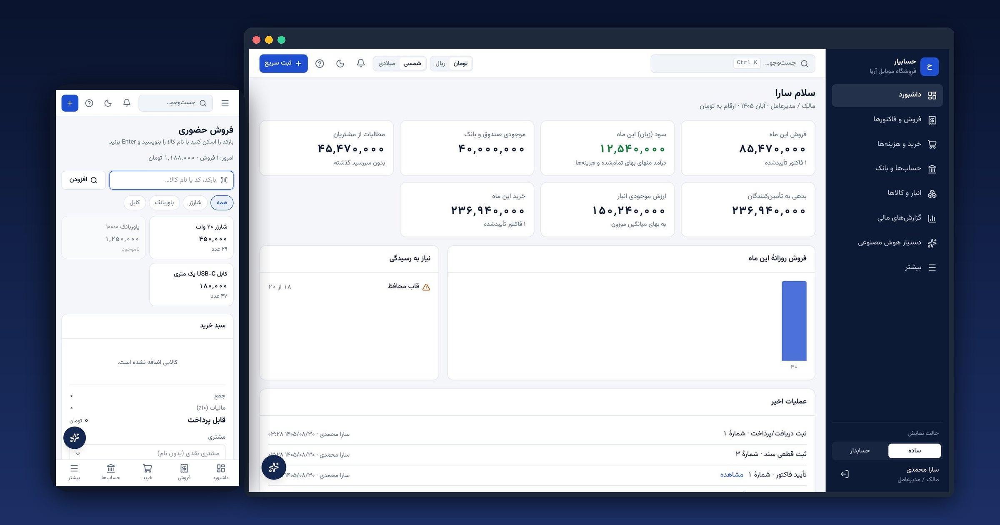

### خلاصه

حسابیار نرم‌افزار حسابداری و مدیریت مالی تحت وب برای کسب‌وکارهای ایرانی است: فروشگاه، پخش، تولید و پیمانکاری. تقویم شمسی، ریال و تومان، راست‌به‌چپ، روی موبایل و دسکتاپ.
هر عدد در گزارش‌ها از سندهای قطعی می‌آید، سند قطعی فقط با سند معکوس اصلاح می‌شود و هر تغییر در رد حسابرسی ثبت می‌شود. دستیار هوشمند فارسی می‌تواند فاکتور بسازد یا به سؤال‌های مالی جواب دهد، اما بدون تأیید کاربر هیچ چیزی را ثبت یا تغییر نمی‌دهد.

**پیش‌نمایش زنده:** [dariush-tech.github.io/hesabyar-showcase](https://dariush-tech.github.io/hesabyar-showcase/)

## Features

- **Accounting core.** Double-entry ledger with group, general, subsidiary and detail accounts; posted entries are immutable and balanced at the database level; fiscal periods and year-end close; full audit trail.
- **Sales, purchasing and inventory.** Invoices with discounts, VAT and credit limits; partial sales and purchase returns with refunds; real-time stock with weighted average cost and reorder alerts.
- **Point of sale.** Barcode scanning, split cash and card payments, change calculation and 80 mm receipts.
- **Treasury, payroll and assets.** Cheques, bank reconciliation and cash-flow forecast; payroll with insurance, tax and payslips; fixed assets with monthly depreciation.
- **Production and contracting.** Bills of materials, work orders, labour and overhead absorption, scrap and unit cost; contract progress statements with statutory deductions, advances and retentions.
- **Assistant and automation.** A Persian assistant that drafts invoices from chat, photos, PDFs or spreadsheets and only acts after the user confirms; rule-based automations with Jalali schedules, in-app notifications and signed webhooks.
- **Integrations and security.** WooCommerce order import, API keys, Excel export, two-factor sign-in, six roles with per-action permissions and full company isolation.

## Screenshots

| | |
|---|---|
| 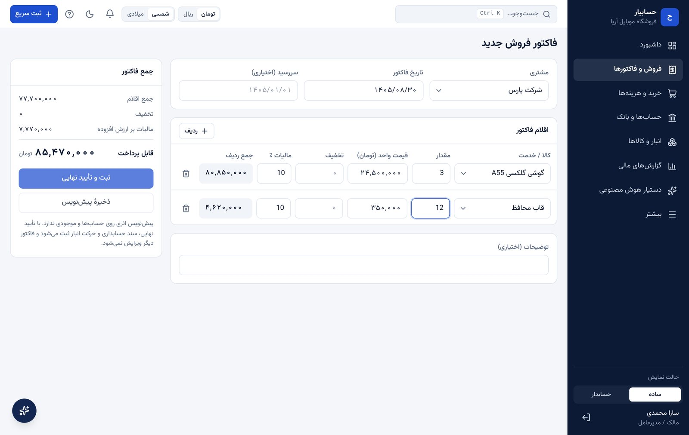 **Sales invoice** | 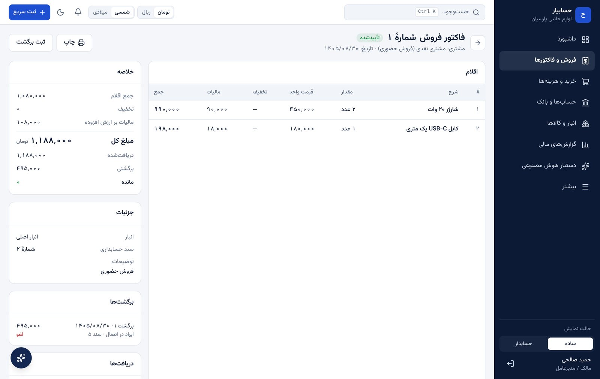 **Invoice with a return and refund** |
| 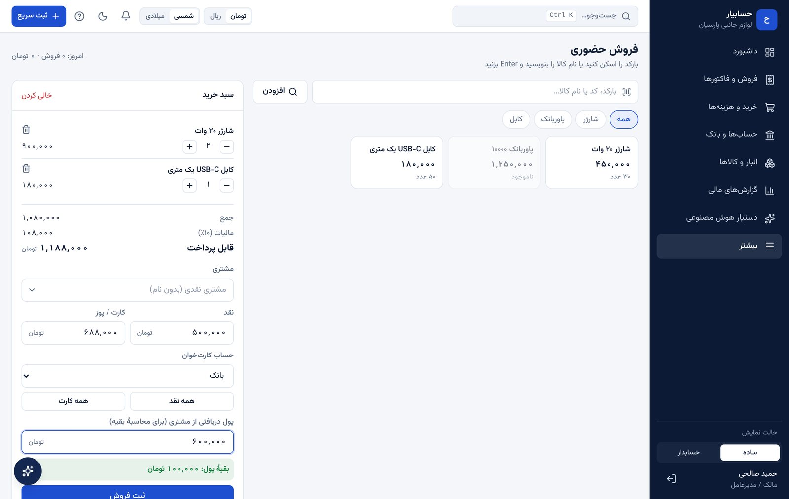 **Point of sale** | 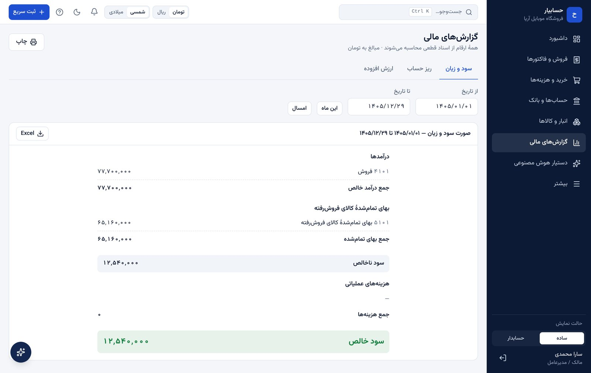 **Profit and loss** |
| 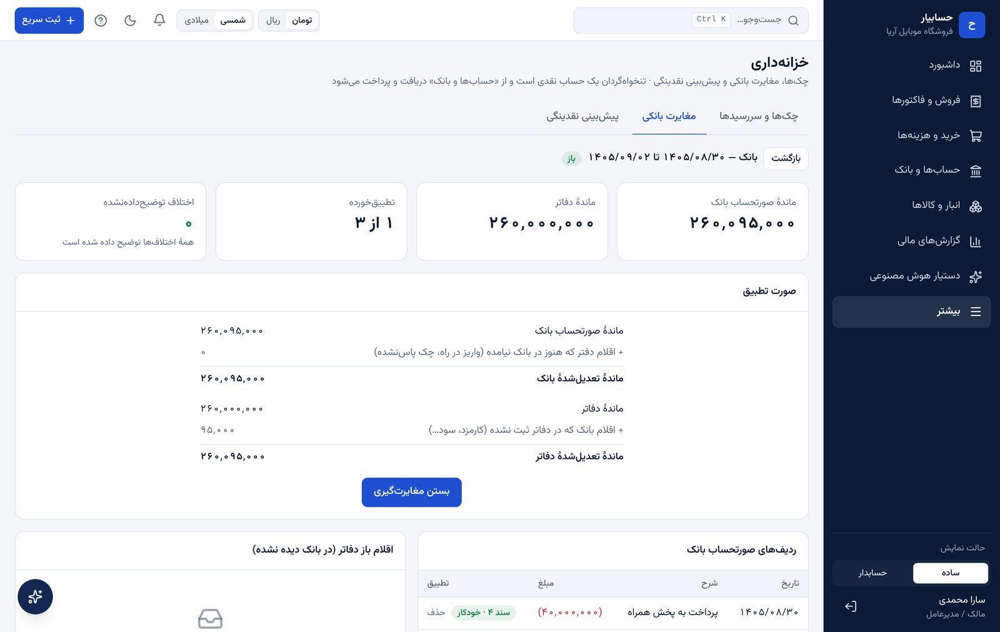 **Bank reconciliation** | 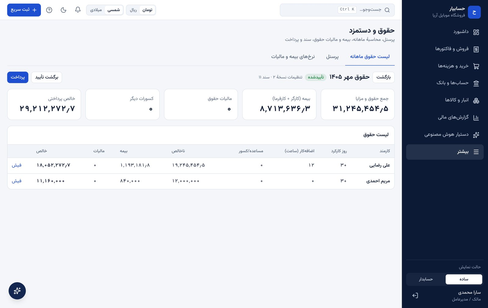 **Payroll** |
| 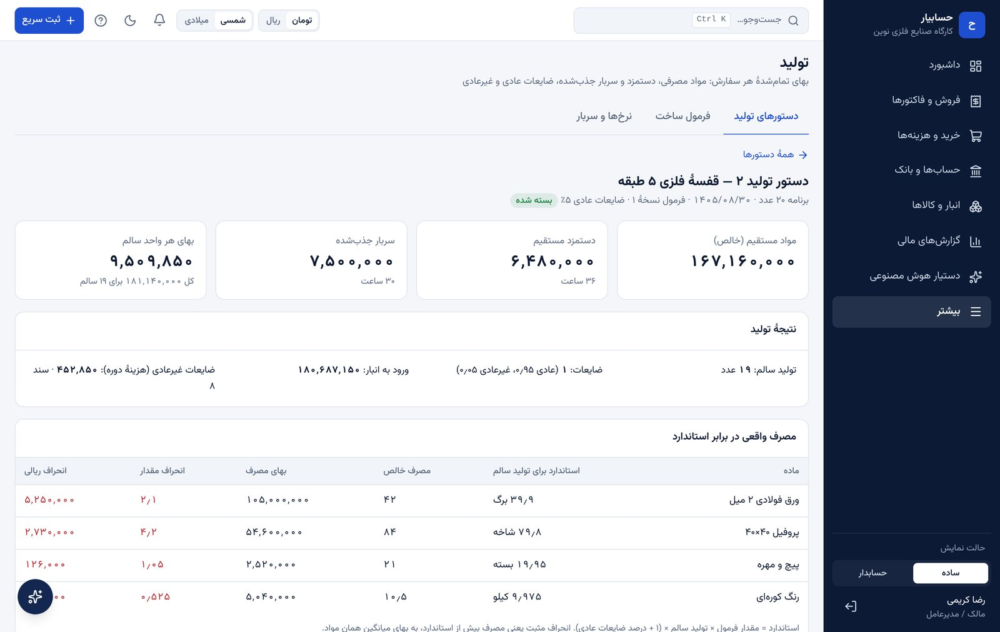 **Work order and unit cost** | 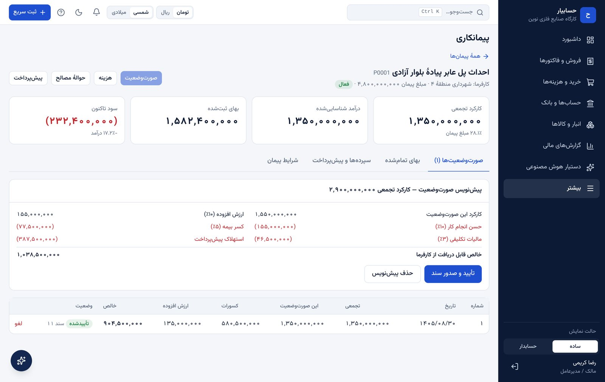 **Contract progress statement** |
| 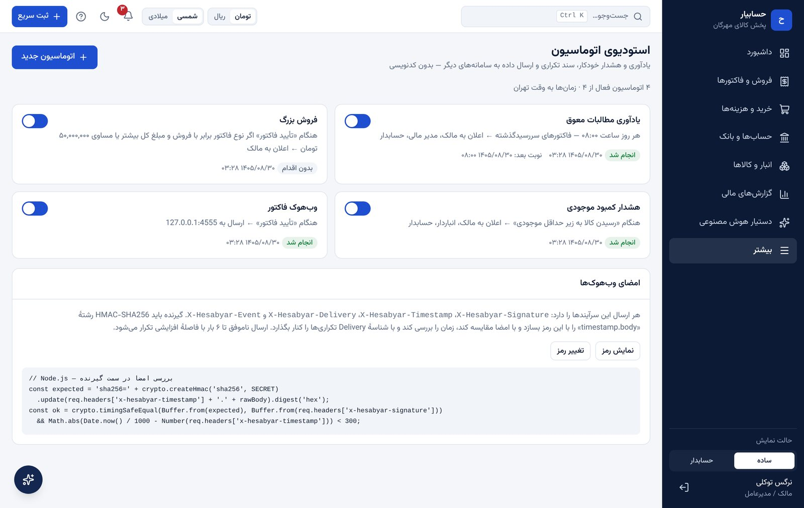 **Automation studio** | 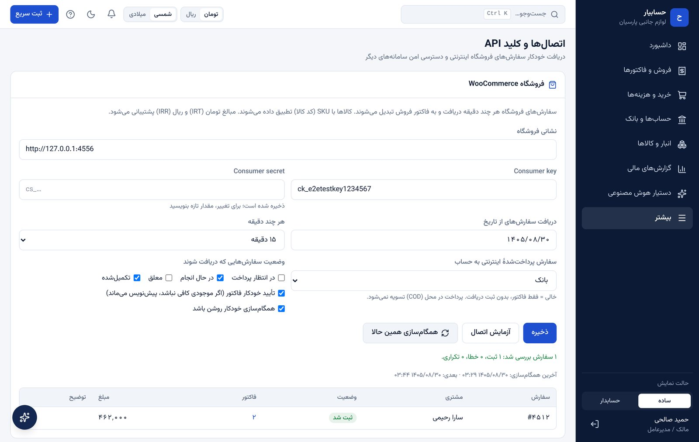 **WooCommerce connection** |
| 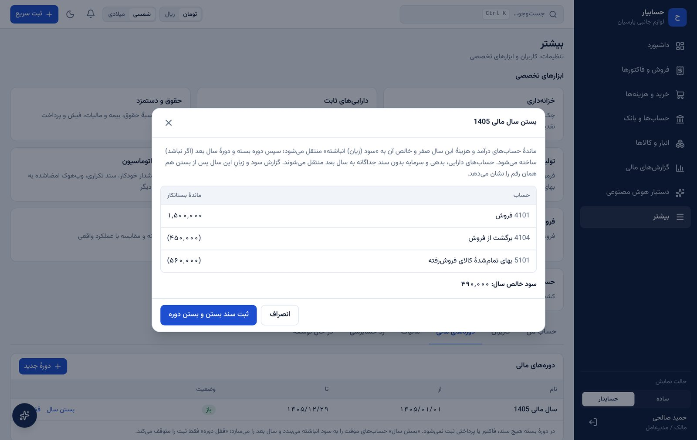 **Year-end close** | 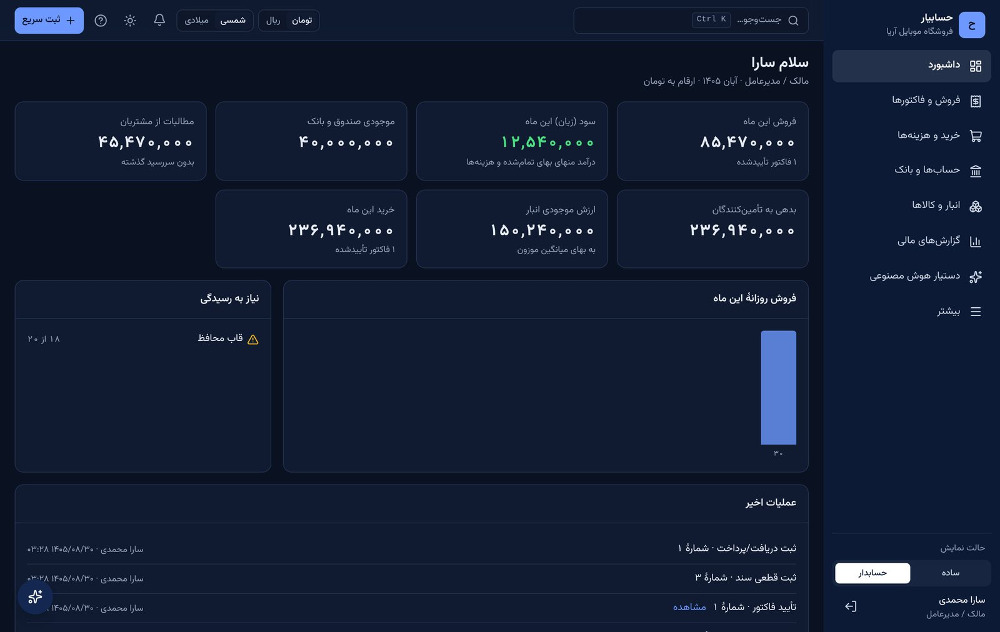 **Dark mode** |

  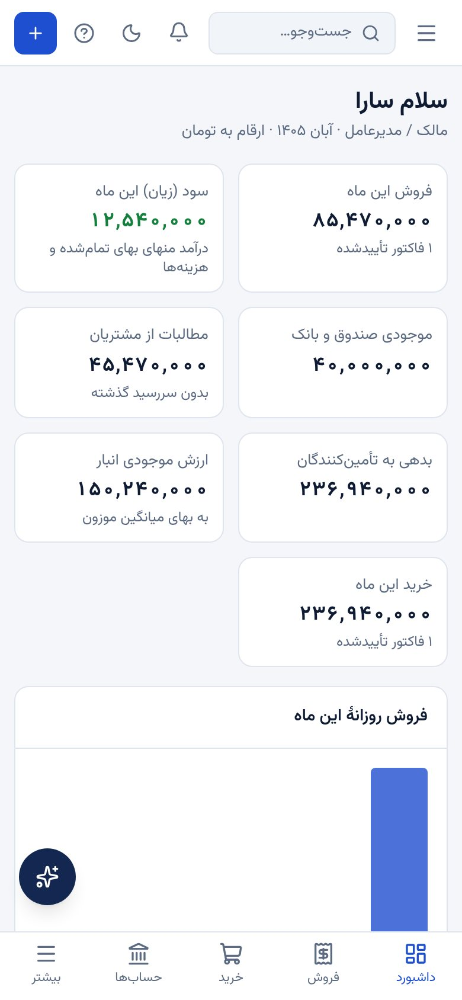
  &nbsp;&nbsp;
  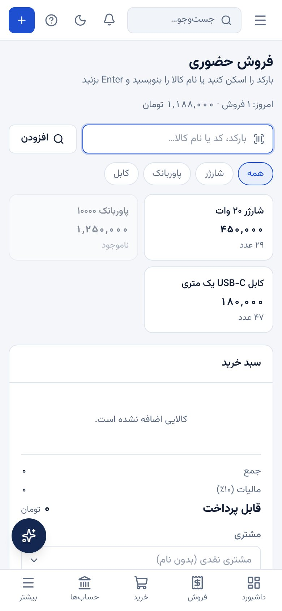

More screens are on the [live preview](https://dariush-tech.github.io/hesabyar-showcase/#gallery).

## Licence

© 2026 Dariush Technology. All rights reserved. This repository contains only the description and screenshots; the application's source code is private and is not licensed for use, copying or redistribution.
